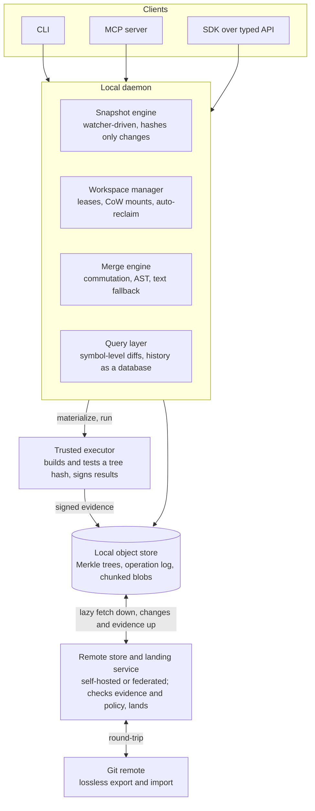

# Reef: Agent-Native Version Control

*Design document. Last updated 2026-10-15.*

## Summary

Reef is a proposed open source version control system built for a world where AI agents author most code. The name is the metaphor: a durable structure built by countless small organisms. It keeps git's content-addressed Merkle storage but replaces git's working model with one suited to many concurrent, speculative, token-constrained authors: the working copy is always a snapshot, changes have stable identities that survive rewrites, conflicts are storable objects rather than blocking states, every operation is undoable, and each change carries signed evidence of the tests and builds run against it.

The most immediate pain it removes is git worktrees. Agents need isolated working directories, but worktrees are full copies with no owner and no expiry, and their dependency directories dwarf the source. We replace them with leased, copy-on-write workspaces that cost only what the agent changed and reclaim themselves when the agent goes away.

The system is a protocol and a daemon, not a hosted service. It works fully local, federates between self-hosted stores, and round-trips to git so one person on a team can adopt it against an ordinary GitHub repository. We recommend building on Jujutsu's data model and Rust crates rather than starting clean. The project lives at [github.com/reef-vcs](https://github.com/reef-vcs).

## Problem

Git was designed for a few dozen humans making a few commits a day. Agents break every assumption behind that design.

- **Commit volume rises by orders of magnitude.** Thousands of small changes a day from dozens of concurrent writers on the same repository. Any operation that costs O(repository size) becomes the bottleneck.
- **Most work is speculative.** An agent tries several approaches and keeps one. Branching, snapshotting, and discarding must be nearly free, and discarded work must clean itself up.
- **The consumer of history is also an agent.** Tokens are a performance metric. A unified diff that costs 40k tokens to read is slow regardless of how fast it computed.
- **Conflicts are routine.** Two agents editing the same file at once is the normal case, not the exception. A conflict that halts the agent in a modal state halts the fleet.
- **Trust shifts from author to evidence.** No human can review every line of agent output. A change must carry proof: which tests ran on exactly this tree, what the build produced, which task and instruction caused it.
- **Git ceremony is pure waste.** Staging areas, detached HEADs, interactive rebase, and parsing porcelain output burn tokens and cause errors. Agents want a typed API, not a shell dialect.

### Worktrees in particular

Git worktrees are the current answer to agent isolation, and they fail in five ways.

1. **Every worktree is a full materialized copy.** Twenty agents means twenty copies of the tree. Git shares nothing below the object store.
2. **The source tree is not the big part.** Each worktree gets its own node_modules, virtualenv, target directory, and build cache. These are often ten times the checkout and git knows nothing about them.
3. **Worktrees have no owner and no expiry.** An agent crashes and its directory, branch, and metadata persist forever. Pruning is manual and only works after the directory is already deleted.
4. **A worktree is bound to a branch.** Two agents cannot sit on the same branch, so agents invent throwaway branch names, which is where branch sprawl comes from.
5. **Worktrees hold the only copy of uncommitted work.** Deleting one to tidy up risks losing something, so nobody deletes anything.

## Goals and non-goals

**Goals**

- Operations cost O(what changed), never O(repository size). Status, snapshot, and diff are instant on a monorepo.
- Hundreds of concurrent agents on one repository with no locks and no coordination between them.
- Workspaces cost disk proportional to the agent's edits and reclaim themselves automatically.
- Conflicts never block. They are stored, delegated, and resolved asynchronously.
- Every mutation is undoable from a single operation log.
- Changes carry signed, verifiable evidence of tests and builds.
- A typed local API with structured output. Agents never parse text.
- Token-efficient views of state and history, including symbol-level diffs.
- Fully local operation with no server, plus federation between self-hosted stores.
- Lossless enough git interop that one developer can adopt it on an existing GitHub project.

**Non-goals**

- Replacing GitHub or any code review platform. Humans keep reviewing where they review today.
- Running builds or tests. The system defines the attestation format and the executor is external.
- A hosted service. The reference implementation is a daemon and a protocol anyone can run.
- Structural merge for every language at launch. We start with the languages agents write most and fall back cleanly.

## Design principles

1. **Snapshots, not commits.** The working copy is always a snapshot. There is no staging area and no uncommitted state. Jujutsu has proven this model and agents work well with it.
2. **Stable identity, mutable content.** A change has a permanent ID that survives rebase and amendment. The content hash is secondary. Agents reference the change ID across sessions without caring that it was rewritten.
3. **Conflicts are first-class objects.** A merge that conflicts still produces a valid snapshot containing the conflict. It can be stored, pushed, handed to a resolver agent, or fixed later. Nothing blocks.
4. **Everything is undoable.** A global operation log records every mutation of repository state, so any agent action reverts in one call. This is the safety net that makes autonomous operation acceptable.
5. **Workspaces are caches, not truth.** Working directories are leased, copy-on-write, and reclaimable. The store always holds the latest snapshot, so deleting a workspace loses nothing.
6. **Hub and ephemeral workspaces, not full distribution.** One authoritative content-addressed store per repository with lazy-fetching clients. Full clones are the exception. Piper and Sapling converged here for the same reasons.
7. **Evidence rides with the change.** Test results, build hashes, and provenance are content-addressed objects linked to the snapshot they were computed against. Landing is gated on evidence, not on who pushed.
8. **API first, CLI second.** A local daemon speaks a typed protocol. The CLI and an MCP server are thin clients. No agent should ever regex a log.

## Data model

Five object kinds, all content-addressed with BLAKE3 and stored in one Merkle structure.

| Object | Identity | Holds | Mutable |
| --- | --- | --- | --- |
| Tree | Content hash | Directory entries with per-entry hashes and modes. Unchanged subtrees share hashes across snapshots. | No |
| Blob | Content hash | File content. Large files split by content-defined chunking so near-duplicates share chunks. | No |
| Snapshot | Content hash | A tree hash, parent snapshot hashes, author, timestamp, and the change ID it belongs to. May contain conflict markers as structured data. | No |
| Change | Stable random ID | A logical unit of work. Points at its current snapshot. Survives rebase, amend, and squash. The thing agents and humans name. Carries dependency edges on other changes, so a stack of changes is explicit. | Yes, pointer only |
| Evidence | Content hash | A signed attestation: the snapshot hash it was computed on, the attestor identity, the kind (test, build, lint, policy), result, and an optional artifact hash. Artifacts live in a separate store with its own retention policy, since evidence volume outgrows code volume at agent scale. | No |

**Operation log.** Every mutation of repository state, including snapshot creation, change rewrites, workspace leases, and landings, appends an operation that records the previous and next state of all affected references. The log is itself content-addressed and forms a chain. Undo is a pointer move, scoped to the operations an agent performed on its own changes. Undoing an operation that another change has built on does not rewrite that change silently; it marks the dependent with a conflict object for its owner to resolve. Concurrent operations from different agents merge as a DAG, so no agent ever waits on another to record its work.

**Conflicts.** A conflicted snapshot stores each hunk as a structured record: the base, each side, and the sides' snapshot hashes. The working copy renders this as markers for tools that need text, but the API exposes it as data. A conflicted snapshot is a legal parent, can be pushed, and can be assigned to another change for resolution. Conflicts also carry backpressure: landing refuses a conflicted change, a conflict whose owner's session has ended moves to a resolver queue with a priority, and a change cannot acquire a second unresolved conflict ancestor without policy approval.

**Stacks.** A change may depend on other changes. The dependency edge is explicit on the change object, so a task decomposed into several changes lands as an ordered stack, and landing can accept a prefix of the stack when a later change fails its gate.

**Proposals.** A proposal is a change or stack put forward for main with its evidence. It is not a separate object; it is the change in its proposed state. A change moves through draft, proposed, queued, landed, and one of declined, withdrawn, or superseded, and the operation log records each transition. The change ID identifies the proposal, so there is no second number to track.

**Provenance.** Each snapshot carries a provenance record: agent identity, model and version, session ID, originating task reference, a hash of the instruction that produced the change, and a signature over all of it. This is what makes a thousand agent commits auditable after the fact.

**Published versus working history.** The operation log keeps every agent step. Landed history is a curated projection that policy produces at landing time, so squashing is a rule rather than a chore and humans read a legible history without agents losing their undo trail.

## Workspaces

A workspace is a materialized directory an agent can run tools in. It is a cache of a snapshot, never the source of truth, and it is designed so that orphaned workspaces cannot exist.

**Always snapshotted.** The daemon snapshots the working copy on every API call and on a short timer, driven by filesystem notifications. Dirty state always exists in the store within seconds of being written. Deleting a workspace therefore loses nothing, which is what makes automatic cleanup safe. These snapshots stay on the machine. Only a change that an agent or human explicitly publishes leaves it, so half-written edits never reach a shared store.

**Leased.** Every workspace records an owner, the change it is working on, a purpose string, and a lease that the agent's session must heartbeat. When the lease lapses, the daemon takes a final snapshot, records it in the operation log, and reclaims the directory. An agent that crashes leaves a snapshot and a log entry, not a directory.

**Copy-on-write materialization.** Creation shares every unchanged byte with the store.

| Platform | Mechanism | Cost to create | Disk per workspace |
| --- | --- | --- | --- |
| Linux | overlayfs: read-only snapshot as lower layer, thin writable upper layer | Mount, milliseconds | Modified files only |
| macOS | APFS file clones over a materialized snapshot | Metadata per file, no data copied | Modified files only |
| Linux with btrfs or XFS | Reflink copy | Metadata per file | Modified files only |
| Sandboxed microVM (Firecracker, gVisor) | Snapshot served from the daemon over virtiofs or NFS; the guest writes to its own upper layer and the daemon still owns the lease | Mount, milliseconds | Modified files only, held by the daemon |
| Fallback | FUSE or NFS loopback mount with lazy fetch on first read | Immediate | Files read plus files modified |

**Dependencies and build state live outside the tree.** The workspace spec declares shared stores to mount or link in: a content-addressed package store in the style of pnpm or Nix, and a build cache keyed by tree hash. Twenty workspaces on the same lockfile share one copy of the dependencies. Shared stores are mounted read-only, verified against the lockfile hash, and written only by the daemon, so an agent running arbitrary code cannot poison another agent's workspace. Build outputs never enter a snapshot. An agent that changes one file inherits cached results for everything else.

**Many tasks need no workspace.** Review, search, analysis, and small edits run against the store through a virtual API: read a file at a snapshot, apply an edit, receive a new snapshot hash. A directory is materialized only when something must execute, such as a build or test run. Most of an agent fleet never touches the filesystem, which cuts workspace count more than any storage trick.

**Decoupled from branches.** A workspace points at a change ID. Several workspaces can sit on the same change, and a workspace can move between changes without being destroyed and recreated.

**Inventory owned by the daemon.** Listing workspaces shows owner, lease state, change, dirtiness, and measured disk usage from one source. Garbage collection reclaims snapshots unreferenced by any named change and older than the undo window, and reports what it reclaimed.

Jujutsu covers roughly a third of this today. It snapshots automatically and supports multiple workspaces, so stale work is never lost. It does not do copy-on-write materialization, leases, shared dependency stores, or the virtual workspace API, and each of its workspaces still costs a full checkout.

## Architecture

Agents talk only to the local daemon. The daemon owns snapshots, workspaces, merging, and queries, and syncs lazily with a remote store that gates landing on signed evidence from a trusted executor.

### Storage

A Merkle tree of directories and files hashed with BLAKE3, which parallelizes across cores. Per-directory hashes make comparing two snapshots of a monorepo O(changed subtrees). Large files use content-defined chunking so near-duplicate blobs across speculative branches share storage. The local store is a cache in front of the remote store: a new workspace pulls metadata and fetches file content on first read. Language servers and build tools walk whole trees and would defeat lazy fetch, so a repository can declare sparse profiles and prefetch hints that materialize the subtrees a task will touch.

Status is answered from an incrementally maintained index fed by filesystem notifications, never from a tree walk. The index is a proper embedded database rather than a flat file, so it stays consistent across concurrent agents on the same machine.

### Merge engine

Three tiers, tried in order.

1. **Patch commutation.** If two changes touch disjoint regions, they merge without inspection. This covers most agent concurrency because agents on different tasks rarely edit the same lines.
2. **Structural merge.** For supported languages, tree-sitter parses both sides and merges at the syntax level, so two agents adding different functions to the same file merge cleanly even when their insertions overlap textually.
3. **Line-based fallback.** A standard three-way merge that produces a first-class conflict object rather than failing.

Formatting runs before hashing in repositories that opt in, so whitespace churn never reaches the merge engine.

Generated files get their own driver class. Lockfiles such as package-lock.json, Cargo.lock, and go.sum are where parallel agents collide most often, and no text or syntax merge helps. The driver merges the manifests and regenerates the lockfile from the result, and the same class covers other derived files a repository declares.

### Landing

An agent proposes a change plus evidence, or a stack of dependent changes as one proposal. The landing service verifies that each evidence object's snapshot hash matches the submitted tree and that the attestor is trusted by repository policy. It applies policy rules such as required test kinds, maximum diff size, forbidden paths, and human sign-off for designated areas. It refuses a change that still contains a conflict.

Landing then rebases onto the current head. A rebase produces a new tree hash, so evidence computed on the submitted tree proves nothing about the rebased one, and disjoint hunks are no guarantee of semantic compatibility: one agent can change a signature while another adds a caller. The landing service is therefore a merge queue. It batches rebased changes, asks the trusted executor to run the required checks on the batch head, lands the batch if the checks pass, and bisects the batch to find the culprit if they fail. A stack lands as a prefix: if a later change fails, the earlier ones still land. Policy can declare an evidence transfer rule for cheap checks such as lint, accepting results from the submitted tree when the hunks commute, so only expensive checks rerun on the batch.

If the rebase does not commute, the proposal returns to its owner with a conflict object, or to the resolver queue if the owner's session has ended. This is a merge queue inside the version control system rather than one bolted onto CI.

### Query layer

History is a database. Agents ask structured questions such as which changes touched a given symbol in the last week and what their test outcomes were, and receive structured rows. Diffs are available at the symbol level as well as the line level, which is both more useful to an agent and far cheaper in tokens than a unified diff.

### Provenance

Each snapshot carries the agent identity, model, session, originating task, and a hash of the instruction that produced it, signed by a short-lived session key. The daemon issues session keys bound to a longer-lived operator or CI identity in the keyless Sigstore pattern, so provenance chains to a person or pipeline without long-lived agent secrets, and a session key can be revoked without touching anything else. Policy can require provenance for landing, and the query layer can filter and aggregate on it.

### API

The daemon exposes a typed protocol over a local socket with structured responses. The CLI and the MCP server are thin clients of the same API, so an agent and a human see identical state. Every call is idempotent where possible and returns the operation log entry it created, so a client can undo exactly what it did.

## Technology choices

Rust end to end for the core, reusing existing open source components for the heavy pieces. The case for Rust is where the ecosystem already is: Jujutsu, gitoxide, tree-sitter bindings, BLAKE3, and Meta's Mononoke are all Rust, so any other language means rewriting or wrapping most of the foundation.

| Component | Choice | Why |
| --- | --- | --- |
| Data model, snapshots, op log, conflicts | [jj-lib](https://github.com/jj-vcs/jj) | Already implements working copy as commit, change IDs, the operation log, and stored conflicts. Apache 2.0 and designed to be embedded. |
| Hashing | [BLAKE3](https://github.com/BLAKE3-team/BLAKE3) | Parallel, fast on large trees, reference implementation in Rust. |
| Chunking | FastCDC | Content-defined chunking so near-duplicate blobs share storage. |
| Git interop | [gitoxide](https://github.com/GitoxideLabs/gitoxide) | Pure Rust git with a native wire protocol. No shelling out, no libgit2. Jujutsu is already migrating to it. |
| Local metadata, index, leases, op log | SQLite | Durable, queryable, one file, readable from every language. The query layer gets SQL for free. |
| Local object cache | Packfile-style files on disk, indexed in SQLite | Simple and inspectable, no second database engine. |
| Filesystem watching | notify crate, [Watchman](https://facebook.github.io/watchman/) as optional backend | notify covers inotify and FSEvents. Watchman scales better on large monorepos and jj already supports it. |
| Workspace materialization | overlayfs and reflinks via syscalls, APFS clonefile, NFS via [nfsserve](https://github.com/xetdata/nfsserve), FUSE via fuser, virtiofsd for microVMs | Each backend is a thin layer over syscalls. nfsserve is a pure Rust NFS server and is the macOS path, since EdenFS found FUSE too fragile there. |
| Structural merge | [tree-sitter](https://tree-sitter.github.io/), starting from [Mergiraf](https://mergiraf.org) | Mergiraf is an existing Rust structural merge tool on tree-sitter with per-language rules. Extend it rather than start over. |
| Symbol model for queries and diffs | [SCIP](https://github.com/sourcegraph/scip), tree-sitter tags as fallback | Cross-language symbol identity that survives moves. Indexers exist for the main languages. |
| Daemon API | gRPC over a Unix socket with [tonic](https://github.com/hyperium/tonic), protobuf schemas | Typed, streaming, and codegen produces the Python and TypeScript SDKs from one schema. |
| MCP server | [rmcp](https://github.com/modelcontextprotocol/rust-sdk), the official Rust MCP SDK | A thin client of the gRPC API so agents and humans see the same state. |
| Evidence and provenance | [in-toto](https://in-toto.io) attestations in DSSE envelopes, sigstore-rs, ed25519 session keys | Standard formats that existing supply chain tooling already verifies. |
| Policy language | [CEL](https://cel.dev) via cel-rust | Non-Turing-complete, auditable, fast to evaluate at landing. Rego is the fallback if policies grow large. |
| Remote store | Rust service, Postgres for metadata, S3-compatible object storage for blobs, the same gRPC protocol as the daemon | Mononoke's shape. Postgres suffices for an open ecosystem store; FoundationDB only if one store must serve a Google-scale monorepo. |
| CLI | clap | Emits JSON by default when stdout is not a terminal. |

**Build on jj-lib, not a fork of the jj binary.** The library is designed to be embedded and its maintainers want it used that way. Forking the CLI would carry UX decisions aimed at humans. Generic improvements such as the gitoxide migration and Watchman support go upstream; workspaces, leases, evidence, and the daemon stay in this project.

**SQLite over RocksDB for the daemon.** RocksDB is what EdenFS uses and scales further, but it is an opaque binary dependency. SQLite gives the history-as-a-database feature almost for free and the daemon's write rate is well within its range. Swap the hot path later only if profiling demands it.

**gRPC over a bespoke protocol.** Agents will be written in Python and TypeScript far more than Rust. Protobuf schemas keep the SDKs in sync with the daemon without hand-maintained bindings, and streaming covers long operations such as fetch and bisect.

**The two real risks are macOS and structural merge.** NFS loopback on macOS works in production at Meta but needs care around lock files and case insensitivity. Mergiraf covers around a dozen languages and its rules will need tuning for the overlapping insertions agents produce. Everything else in the table is well-trodden.

## Human interface

GitHub's interface is organized around commits, branches, and pull requests because it assumes a human wrote the code and a human will read every line. With agents, the human's job becomes directing work, approving landings on evidence, handling what agents cannot, and auditing afterward. The interface is organized around those four jobs. Everything else stays headless.

### What humans do

**Approve, not read.** The review surface opens on intent, then evidence, then diff, in that order. Intent is the task, the agent's summary, and the instruction that produced the change. Evidence is a panel showing which checks ran on which tree, who attested, whether policy is satisfied, and which changed symbols are covered by tests that ran. The diff defaults to a symbol-level summary with affected call sites and expands to lines on demand. Most approvals never reach the line view.

**Review stacks, not commits.** A task decomposed into several changes shows as one proposal with the decomposition visible. The reviewer accepts the proposal or a prefix of its stack. Comments are addressed to the originating agent and resume its session, so a review comment is an instruction rather than a note for a human to act on later.

**Handle exceptions.** A triage inbox is the home page, not a feed. It has three buckets: needs you now (policy requires sign-off, a conflict nobody owns, an agent asking for help, a batch that failed bisect), watching (proposals you asked for, in flight), and landed since you last looked (a digest, not a list). Attention is the scarce resource and routing it is the interface's main job.

**Resolve conflicts in place.** Conflicts are objects, so they get a real view: base and both sides with the provenance of each, one-click assignment to an agent or to yourself, and in-browser resolution that produces a new snapshot.

**Audit and explain.** For any line: why it exists, which task, which agent, which instruction, which evidence landed it. For any symbol: every change that touched it, filtered by agent, model, or time. Two history views, the curated landed history and the raw operation log, with a timeline to scrub and revert from.

**Operate the fleet.** A dashboard of proposals in flight, workspaces with owner, lease, and disk, the landing queue with batches and bisects in progress, the conflict queue, and which agent is on which change. Policy has an editor with simulation that shows which recent landings a proposed rule would have blocked.

### What shrinks or disappears

- **Branches** mostly leave the human interface. Changes and stacks replace them.
- **Pull requests** become proposals. A proposal is a change or stack, with its evidence, put forward for main. It is the change itself in its proposed state, identified by its change ID. CI results are replaced by verified evidence objects that show whether the attestor is trusted.
- **Commit messages** become agent summaries plus structured provenance. Humans rarely write them.
- **The file browser** stays but gains a time axis and symbol search, because that is how humans navigate agent-sized histories.

### Where it lives

Three surfaces over the same API, so a human and an agent always see identical state.

| Surface | Role | Model |
| --- | --- | --- |
| Local web UI served by the daemon | Your stacks, your workspaces, what agents are doing in your repository right now. No server required. | Sapling's Interactive Smartlog |
| IDE panel | Stack and conflict views inside VS Code or JetBrains, with agent changes landing into your workspace visible as they happen. Where human-authored changes are made; they look identical to agent changes everywhere else. | jj and Sapling IDE extensions |
| Hosted review UI on the remote store | Shared review, triage inbox, audit, and fleet operation. Anyone running a store runs this. | GitHub, Phabricator |

### What stays headless

Everything agents do: creating and reclaiming workspaces, snapshotting, submitting, responding to review comments, resolving assigned conflicts, querying history, rebasing. Agents never see the interface. The design rule is that no state exists that the interface can show and the API cannot, and no action exists in the interface that is not one API call, so an agent could do anything a human does.

The review comment that becomes an instruction is the most powerful feature here and the easiest to abuse, since a casual note now spawns work and consumes compute. Comments are explicitly marked as instructions or as notes, and an instruction shows its estimated cost before it runs.

## Open ecosystem

The system is open source and targets the whole ecosystem, not one organization's monorepo. That changes four things relative to the internal systems it borrows from.

**The hub is a protocol, not a service.** Anyone runs a store server for their repository the way anyone hosts a git remote. The daemon also works with no server at all, holding the full store locally. Stores federate: a fork is a store that tracks another store, and changes flow between them with their evidence attached.

**Trust is declared per repository.** No executor can be assumed trustworthy. Evidence is a signed attestation in the Sigstore style, and each repository's policy names the attestor identities it accepts. A solo developer trusts their own machine. A large project trusts its CI identity and nothing else. Evidence from an untrusted attestor is stored but carries no weight at landing.

**Git interop is the adoption path for years.** Humans review on GitHub and will for the foreseeable future. The native store must round-trip to git well enough that one person on a team can use the new system against a repository nobody else has heard of. This means speaking the git wire protocol natively rather than shelling out, exporting a clean landed history without agent noise, and importing teammates' git commits as changes whose IDs derive deterministically from the commit hash, so two people importing the same commit name the same change. Conflicts, evidence, and provenance do not survive export to git and are kept on the native side only.

**Governance and licensing matter.** Apache 2.0 or similar, a published protocol specification separate from the reference implementation, and a conformance suite so alternative stores and clients can exist. The protocol is the product; the daemon is one implementation of it.

## Prior art

Every piece of this design exists somewhere. The contribution is combining them around the agent workload and adding the workspace, evidence, and API layers nobody has built.

| System | What we borrow | What it lacks for agents |
| --- | --- | --- |
| [Jujutsu](https://github.com/jj-vcs/jj) | Working copy as commit, stable change IDs, operation log, stored conflicts, git backend, Rust library design | Copy-on-write workspaces, leases, evidence, typed API, lazy store |
| [Pijul](https://pijul.org) and Darcs | Patch commutation theory; independence of changes as the basis for lock-free concurrency | Ecosystem, git interop, scale |
| [Sapling](https://sapling-scm.com), EdenFS, Mononoke | Lazy virtual checkouts at monorepo scale, server-side source of truth, scalable server | Designed around one company's infrastructure; no evidence or provenance model |
| Google Piper and CitC | Hub model with ephemeral cloud workspaces; proof that full clones are unnecessary | Closed, single-organization |
| [Bazel](https://bazel.build) remote cache | Tree hash as the key for build and test outputs, so unchanged parts are never rebuilt | Not a version control concern on its own |
| [Fossil](https://fossil-scm.org) | Tickets and wiki inside the repository, so task context lives next to the code | Single-writer model, no agent concurrency |
| [Sigstore](https://sigstore.dev) and in-toto | Signed attestation format and keyless identity for evidence | Not integrated with version control |
| [pnpm](https://pnpm.io) and Nix | Content-addressed shared dependency stores linked into many working directories | Not coordinated with workspace lifecycle |
| Git | Content-addressed Merkle storage, packfiles, the wire protocol, and the ecosystem we must interoperate with | Everything this document is about |

## Hard problems and open questions

- **Lossless git interop is the hardest engineering problem.** Jujutsu's git backend shows both the shape and the cost. Change IDs, conflicts, evidence, and provenance have no git representation. We need a clear rule for what is lost on export and how it is reconstructed on import, and a test suite that round-trips real repositories.
- **Structural merge is per-language work.** Each language needs a grammar, merge rules, and a formatter contract. Start with Python, TypeScript, Go, and Rust, measure how often the fallback fires, and expand from there.
- **Evidence can be forged by the agent that produced it.** Only attestations from executors the repository trusts carry weight. The executor must run in an environment the submitting agent cannot tamper with, which pushes toward hermetic builds and keyless signing. The version control system owns the attestation format, not the execution.
- **Published history must stay legible.** Agents produce enormous working histories. The landing projection must squash and summarize by policy without destroying the operation log that agents need for undo and audit.
- **macOS has no overlayfs.** APFS clones give copy-on-write at the file level but require materializing a snapshot once per machine. FUSE on macOS is fragile. Measuring real workspace creation times on both platforms is early work.
- **Lease tuning is a product decision.** Too short and a slow agent loses its workspace mid-task. Too long and disk fills. The snapshot-on-expiry design makes a wrong choice recoverable, but defaults still matter.
- **Semantic diffs need a stable symbol model.** Symbol-level queries across languages need a shared notion of a symbol and its location that survives renames and moves. Tree-sitter gives syntax, not semantics, so some of this will be heuristic.
- **What is the unit of review?** Humans today review branches. If agents produce many small changes with evidence attached, review may shift to intent and evidence rather than lines. The system should support both without deciding for the team.
- **Who runs the public stores?** The protocol allows anyone to host, but the ecosystem needs at least one reliable public store for the git interop story to be credible. This is a sustainability question more than a technical one.

## Roadmap

Build on Jujutsu's data model and crates rather than starting clean. Each phase ships something independently useful, and the first phase alone removes the worktree problem.

1. **Leased copy-on-write workspaces over Jujutsu.** A daemon that creates workspaces via overlayfs or APFS clones, snapshots on a watcher, heartbeats leases, and reclaims expired workspaces with a final snapshot. Shared dependency store mounting. This can ship as a standalone tool against existing jj repositories.
2. **Typed API and MCP server.** Structured status, snapshot, diff, log, and undo over a local socket, with the CLI rewritten as a client. Symbol-level diffs for the first supported languages. This is where agent token waste drops sharply.
3. **Evidence objects and landing gate.** The attestation format, trusted attestor policy, and a landing service that verifies evidence and rebases. Works against a self-hosted store or, in degraded form, against a git remote with evidence kept locally.
4. **Shared lazy object store.** A store server speaking the native protocol, with lazy fetch into the local cache and federation between stores. Full clones become optional.
5. **Structural merge.** Tree-sitter based merge for Python, TypeScript, Go, and Rust, with measured fallback rates guiding which languages come next.
6. **Protocol specification and conformance suite.** Published once the first four phases have stabilized in practice, so alternative implementations can exist.

The decision to make first is whether phase one is a contribution to Jujutsu itself or a separate project that depends on it. A separate project moves faster and can later upstream what fits.
